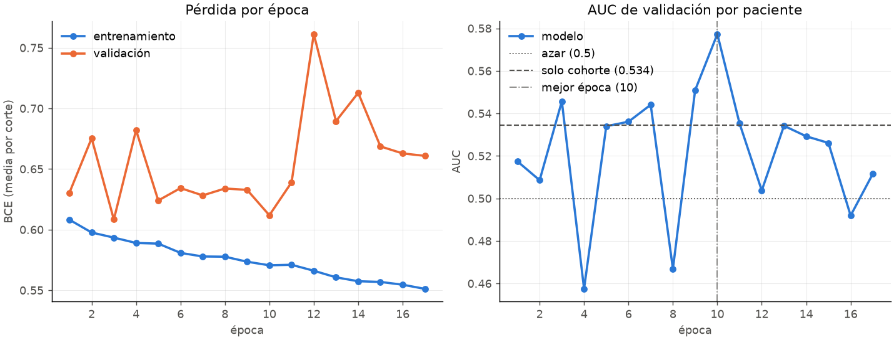
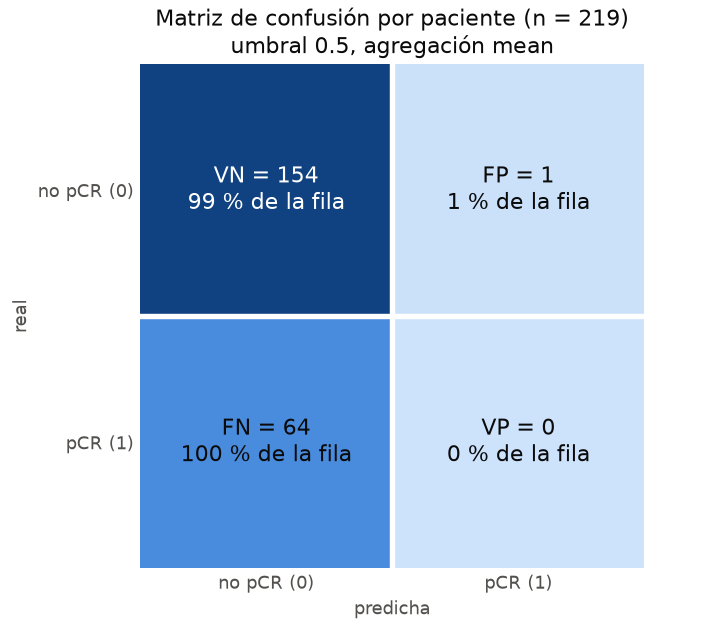
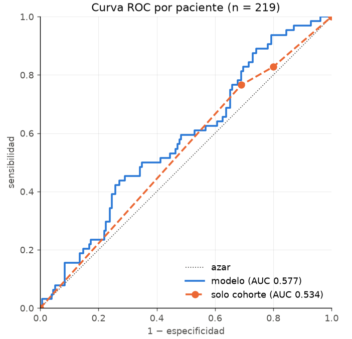
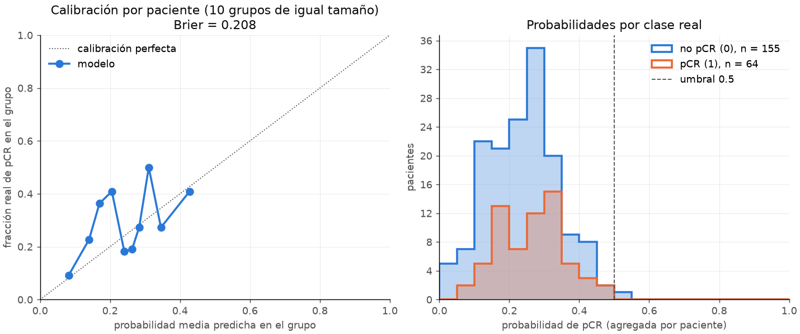

# Informe: 20261022_040447_aumento_30ep_gpu

- Validación interna: fold 0 (219 pacientes). Test no se ha usado.
- Modelo: CNNBase (98.049 parámetros), dispositivo cuda (AMD Radeon RX 6700 XT).
- pos_weight: no; épocas ejecutadas: 17; mejor época: 10.
- Optimizador AdamW, weight decay 0; aumento de datos: volteo_h0.5_rot10.
- Métricas por paciente: agregación `mean` de las probabilidades de sus cortes, umbral 0.5.

## Métricas del mejor modelo

| métrica | valor |
|---|---|
| AUC | 0.577 |
| sensibilidad | 0.000 |
| especificidad | 0.994 |
| accuracy | 0.703 |
| precisión | 0.000 |
| Brier | 0.208 |
| probabilidad media predicha | 0.247 |
| tasa real de pCR | 0.292 |
| AUC solo cohorte | 0.534 |

## Por cohorte

| cohorte | pacientes | pCR_1 | tasa_pCR | auc | sensibilidad | especificidad | accuracy | precision | VP | VN | FP | FN |
|---|---|---|---|---|---|---|---|---|---|---|---|---|
| I-SPY1 | 21 | 4 | 0.190 | 0.706 | 0.000 | 1.000 | 0.810 | — | 0 | 17 | 0 | 4 |
| I-SPY2 | 156 | 49 | 0.314 | 0.570 | 0.000 | 0.991 | 0.679 | 0.000 | 0 | 106 | 1 | 49 |
| Duke | 42 | 11 | 0.262 | 0.528 | 0.000 | 1.000 | 0.738 | — | 0 | 31 | 0 | 11 |
| Todas | 219 | 64 | 0.292 | 0.577 | 0.000 | 0.994 | 0.703 | 0.000 | 0 | 154 | 1 | 64 |

## Referencia "solo cohorte"

A cada paciente de validación se le asigna la tasa de pCR de su cohorte en los pacientes de entrenamiento. Dentro de una cohorte esa referencia es constante, así que el AUC por cohorte del modelo mide lo que aporta más allá de saber de qué cohorte viene la imagen.

| cohorte | tasa_pCR_entrenamiento |
|---|---|
| I-SPY1 | 0.265 |
| I-SPY2 | 0.323 |
| Duke | 0.198 |

AUC solo cohorte: **0.534** frente a **0.577** del modelo.

## Gráficas

 

