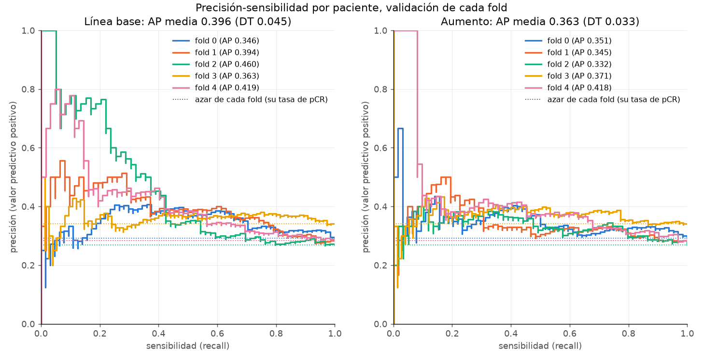

# Validación cruzada de 5 folds: línea base frente a aumento

Métricas de validación por paciente (agregación media) del mejor modelo de cada ejecución,
elegido con el criterio con que se entrenó (`auc`: el AUC de cada época). La desviación
típica es la muestral (ddof=1) sobre los 5 folds.

## AUC

| fold | AUC línea base | AUC aumento | aumento - línea base | AUC solo cohorte |
|---|---|---|---|---|
| 0 | 0.598 | 0.577 | -0.021 | 0.534 |
| 1 | 0.626 | 0.569 | -0.057 | 0.526 |
| 2 | 0.608 | 0.600 | -0.008 | 0.538 |
| 3 | 0.540 | 0.549 | +0.009 | 0.593 |
| 4 | 0.611 | 0.614 | +0.004 | 0.554 |
| media | 0.597 | 0.582 | -0.015 | 0.549 |
| desv_tipica | 0.033 | 0.026 | 0.026 | 0.027 |

El aumento supera a la línea base en 2 de 5 folds.

## Average precision (área bajo la curva precisión-sensibilidad)

La AP del azar es la tasa de pCR de la validación de cada fold.

| fold | AP línea base | AP aumento | AP del azar |
|---|---|---|---|
| 0 | 0.346 | 0.351 | 0.292 |
| 1 | 0.394 | 0.345 | 0.283 |
| 2 | 0.460 | 0.332 | 0.268 |
| 3 | 0.363 | 0.371 | 0.341 |
| 4 | 0.419 | 0.418 | 0.283 |
| media | 0.396 | 0.363 | 0.294 |
| desv_tipica | 0.045 | 0.033 | 0.028 |

## Criterio auc_suavizado, reconstruido

Qué época habría guardado el criterio auc_suavizado (media del AUC de la época con la
anterior y la siguiente; en los extremos, las disponibles) con la misma paciencia, y su
AUC. Se reconstruye desde metricas_epoca.csv: el criterio no cambia el entrenamiento y en
esta GPU el entrenamiento es determinista. Es exacta si la ejecución habría parado dentro
de las épocas entrenadas. Si no, la época elegida es provisional: se mantiene salvo que el
AUC de la primera época no entrenada hubiera superado el valor de la última columna.

| configuración | fold | épocas entrenadas | criterio auc: época (AUC) | auc_suavizado: época (AUC; valor suavizado) | exacta | cambia si la época siguiente da AUC > |
|---|---|---|---|---|---|---|
| Línea base | 0 | 20 | 10 (0.598) | 10 (0.598; 0.569) | no | 0.563 |
| Línea base | 1 | 23 | 13 (0.626) | 13 (0.626; 0.606) | no | 0.669 |
| Línea base | 2 | 30 | 22 (0.608) | 22 (0.608; 0.590) | sí | — |
| Línea base | 3 | 26 | 16 (0.540) | 25 (0.523; 0.493) | no | harían falta varias épocas |
| Línea base | 4 | 15 | 5 (0.611) | 6 (0.572; 0.596) | no | harían falta varias épocas |
| Aumento | 0 | 20 | 10 (0.577) | 10 (0.577; 0.555) | no | 0.543 |
| Aumento | 1 | 23 | 13 (0.569) | 14 (0.509; 0.533) | no | harían falta varias épocas |
| Aumento | 2 | 12 | 2 (0.600) | 1 (0.589; 0.595) | sí | — |
| Aumento | 3 | 22 | 12 (0.549) | 13 (0.532; 0.534) | no | harían falta varias épocas |
| Aumento | 4 | 11 | 1 (0.614) | 6 (0.614; 0.587) | no | harían falta varias épocas |

Media de los 5 folds con auc_suavizado (2 de 10 reconstrucciones exactas; las demás, provisionales): Línea base 0.586 (DT 0.040), Aumento 0.564 (DT 0.043); aumento - línea base -0.021 (DT 0.059).

## Ejecuciones usadas

| configuración | fold | ejecución | mejor época | épocas ejecutadas |
|---|---|---|---|---|
| Línea base | 0 | 20261022_044451_cv_baseline_f0 | 10 | 20 |
| Línea base | 1 | 20261022_045427_cv_baseline_f1 | 13 | 23 |
| Línea base | 2 | 20261022_050538_cv_baseline_f2 | 22 | 30 |
| Línea base | 3 | 20261022_052003_cv_baseline_f3 | 16 | 26 |
| Línea base | 4 | 20261022_053232_cv_baseline_f4 | 5 | 15 |
| Aumento | 0 | 20261022_053954_cv_aumento_f0 | 10 | 20 |
| Aumento | 1 | 20261022_054946_cv_aumento_f1 | 13 | 23 |
| Aumento | 2 | 20261022_060058_cv_aumento_f2 | 2 | 12 |
| Aumento | 3 | 20261022_060652_cv_aumento_f3 | 12 | 22 |
| Aumento | 4 | 20261022_061736_cv_aumento_f4 | 1 | 11 |
